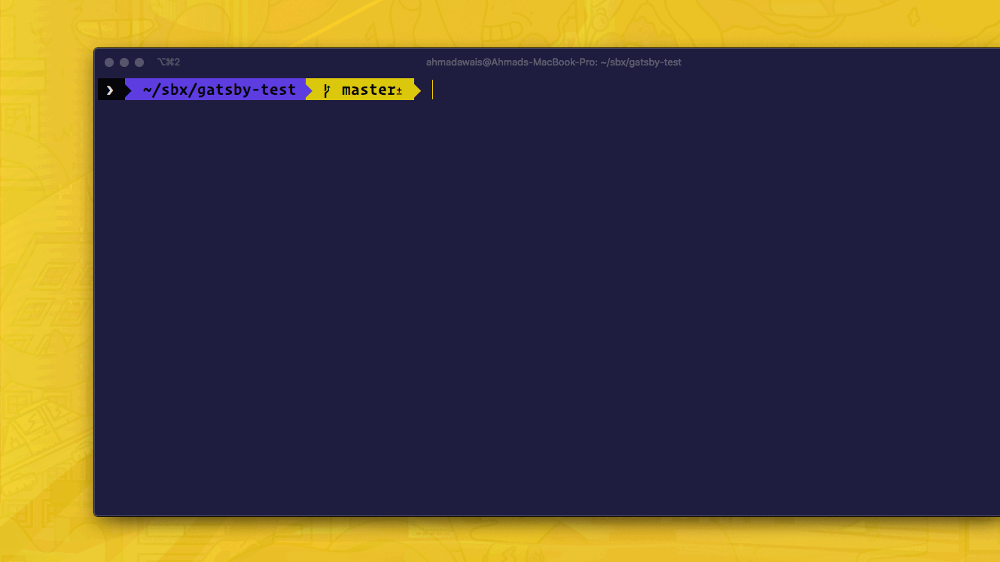

<h1 align="center">
  <a href="./../../"></a>
	<br>

[](https://www.npmjs.com/package/gatsby-package-manager) [](https://VSCode.pro/?utm_source=GitHubFOSS)
[](https://twitter.com/mrahmadawais/)

Gatsby Package Manager `gpm`

</h1>

<p align="center">
The Gatsby Package Manager (gpm) helps you install a Gatsby package with all of its dependencies. It also allows you to read the docs for a package right there in the command line — without having to browse any sites.
</p>

<br>

[](./../../)

## Install

```sh
# Install globally via npm.
npm install -g gatsby-package-manager

# OR: Install globally via yarn.
yarn global add gatsby-package-manager
```

[](./../../)

> Now you have access to `gpm` or `gatsby-package-manager` in your command line.

<br>

[](./../../)

## Usage

### ❯ Install a package

Installs a Gatsby package with all of its peer dependencies.

```sh
# 1: Interactive mode.
# Type `gpm` and answer the questions asked.
gpm

# Alternatively, you can also run it via:
gatsby-package-manager

# 2: Direct mode.
# Several ways to run the same command.
gpm install <pkgName>
gpm i <pkgName>
gpm install gatsby-plugin-mdx
gpm i gatsby-plugin-mdx
```

[](./../../)

### ❯ Docs for a package

Prints the docs, i.e., `readme.md` file of a package in the command line.

```sh
# Several ways to run the same command.
gpm docs <pkgName>
gpm d <pkgName>
gpm docs gatsby-plugin-mdx
gpm d gatsby-plugin-mdx
```

[](./../../)


### ❯ Configure `npm` or `yarn`

The `gatsby-package-manager (gpm)` stores your choice of using  `npm` or `yarn` in `~/.config/configstore/gatsby-package-manager.json` file. This choice can be re-configured by using the option `--config` or `-c` when running `gpm`.

```sh
gpm --config
gpm -c
gpm i gatsby-plugin-mdx -c
```

### ❯ Help documentation

You can run `gpm --help` or `gpm -h` to access the help documentation.

<br />

[](./../../)

## API: Plugin Authors

Make sure you mention all the extra dependencies as `peerDependencies` in the package.json file.

The `peerDependencies` in the `package.json` is what `gatsby-package-manager` looks for. For example: The `gatsby-plugin-mdx` has defined two [peerDependencies](https://github.com/gatsbyjs/gatsby/blob/master/packages/gatsby-plugin-mdx/package.json#L16-L19) `@mdx-js/mdx` and `@mdx-js/react` which are required for the [installation](https://github.com/gatsbyjs/gatsby/tree/master/packages/gatsby-plugin-mdx#installation).

<br />

[](changelog.md)

## Changelog

[❯ Read the changelog here →](changelog.md)

<br>

<small>**KEY**: `📦 NEW`, `👌 IMPROVE`, `🐛 FIX`, `📖 DOC`, `🚀 RELEASE`, and `✅ TEST`

> _I use [Emoji-log](https://github.com/ahmadawais/Emoji-Log), you should try it and simplify your git commits._

</small>

Nothing's ever complete, so bear with me while we keep iterating towards a better future.

> ```html
> 'Coz every night I lie in bed
> The brightest colors fill my head
> A million dreams are keeping me awake
> I think of what the world could be
> A vision of the one I see
> A million dreams is all it's gonna take
> A million dreams for the world we're gonna make ...
> ```
> ... _listen to → [A million dreams!](https://www.youtube.com/watch?v=pSQk-4fddDI)_

<br>

[](./../../)

## License & Conduct

- MIT © [Ahmad Awais](https://twitter.com/MrAhmadAwais/)
- Logo by [Saqib Ameen](https://github.com/ahmadawais/gatsby-package-manager/issues/1)
- [Code of Conduct](code-of-conduct.md)
- [Contribute to `gatsby-package-manager`](contributing.md)

<br>

[](./../../)

## Connect

<div align="left">
    <p><a href="https://github.com/ahmadawais"></a>&nbsp;<small><strong>(follow)</strong> To stay up to date on free & open-source software</small></p>
    <p><a href="https://twitter.com/MrAhmadAwais/"></a>&nbsp;<small><strong>(follow)</strong> To get #OneDevMinute daily hot tips & trolls</small></p>
    <p><a href="https://www.youtube.com/AhmadAwais"></a>&nbsp;<small><strong>(subscribe)</strong> To tech talks & #OneDevMinute videos</small></p>
    <p><a href="https://AhmadAwais.com/"></a>&nbsp;<small><strong>(read)</strong> In-depth & long form technical articles</small></p>
    <p><a href="https://www.linkedin.com/in/MrAhmadAwais/"></a>&nbsp;<small><strong>(connect)</strong> On the LinkedIn profile y'all</small></p>
</div>

